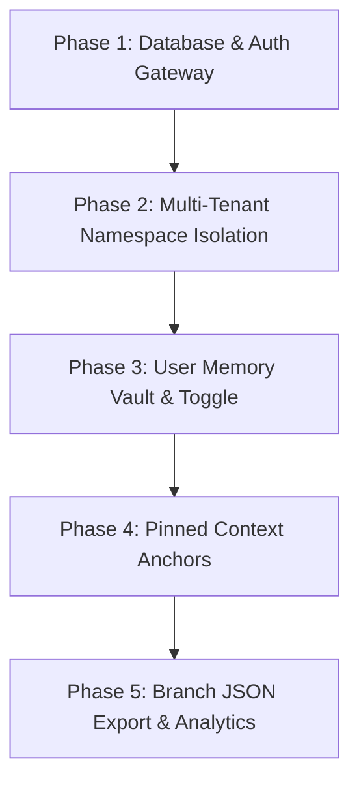

# NeuraStitch AI: 5-Phase Launch Roadmap & Feature Log

This document serves as the definitive reference for the NeuraStitch feature matrix and the sequential development roadmap to roll out user authentication, multi-tenant Qdrant isolation, user profile memory vaults, pinned context anchors, and developer branch JSON exports.

---

## 1. Feature Matrix (Current State)

### 🌐 B2C Free Tier (Local-First Sandbox)
* **Local IndexedDB Engine**: Stores conversation nodes and sessions completely client-side in browser storage via Dexie.js ([db.ts](file:///d:/Final Projects/LLM State Manager/NeuraStitch/frontend/lib/db.ts)).
* **Stateless Token Streaming**: Calls `/chat/stateless` in [main.py](file:///d:/Final Projects/LLM State Manager/NeuraStitch/backend/main.py#L201), passing transient message history vectors without writing anything to the server database.
* **BYOK Credentials Wallet**: Users input their private API keys (Gemini, OpenAI, Groq, OpenRouter) which are cached client-side in browser state and passed ephemerally in headers.
* **Visual Version-Control Canvas**: Renders nodes and branching lineages dynamically using React Flow ([free/page.tsx](file:///d:/Final Projects/LLM State Manager/NeuraStitch/frontend/app/free/page.tsx)).

### ⚡ B2C Premium Tier (Cloud-Synced Virtues)
* **Bi-directional Cloud Sync**: Pushes local logs and merges remote nodes using `/api/sync/push` and `/api/sync/pull` in [main.py](file:///d:/Final Projects/LLM State Manager/NeuraStitch/backend/main.py#L437).
* **Neon Serverless PostgreSQL Database**: Relational source of truth for saving nodes, branches, parent-child links, and summary nodes in [database.py](file:///d:/Final Projects/LLM State Manager/NeuraStitch/backend/database.py).
* **Qdrant Cloud Vector Integration**: Vectorizes user queries and runs cosine similarity matches on session history in [memory.py](file:///d:/Final Projects/LLM State Manager/NeuraStitch/backend/memory.py#L115).
* **Automatic Context Condenser**: Background worker in [condenser.py](file:///d:/Final Projects/LLM State Manager/NeuraStitch/backend/condenser.py) that collapses older turns along the active branch lineage into high-density System Summary cards.

---

## 2. Phased Launch Roadmap

### 🔑 Phase 1: Database & Auth Gateway (Foundations)
* **Goal**: Establish user registration, logins, and API request token guards.
* **Database Updates**:
  * Add `User` model to [database.py](file:///d:/Final Projects/LLM State Manager/NeuraStitch/backend/database.py) mapping to a new `users` table:
    * `id`: String(36) primary key (UUID).
    * `email`: String(255) unique, indexed.
    * `password_hash`: String(255) encrypted.
    * `is_premium`: Boolean, default `False`.
    * `share_profile_memory`: Boolean, default `True`.
* **API Endpoints**:
  * `POST /api/auth/register`: Create user record, generate platform `user_id` (UUID).
  * `POST /api/auth/login`: Validate hash, return JWT token.
* **Verification Plan**:
  * Register new user via Swagger UI (`/docs`).
  * Obtain JWT, decode it to confirm payload properties (`user_id`, `email`).
  * Verify password salt encryption.

### 🔒 Phase 2: Multi-Tenant Vector Namespace Isolation
* **Goal**: Isolate Qdrant vectors and SQL data by user namespaces.
* **Database Updates**:
  * Add `user_id` foreign key column to the `Message` table in [database.py](file:///d:/Final Projects/LLM State Manager/NeuraStitch/backend/database.py).
* **Qdrant Vector Updates**:
  * Modify `upsert_message_vector` in [memory.py](file:///d:/Final Projects/LLM State Manager/NeuraStitch/backend/memory.py) to tag points with `user_id`.
  * Update `search_similar_message_ids` in [memory.py](file:///d:/Final Projects/LLM State Manager/NeuraStitch/backend/memory.py) to add a strict filter condition: `FieldCondition(key="user_id", match=MatchValue(value=user_id))`.
* **Verification Plan**:
  * Log in user A and index memory. Log in user B.
  * Search memories as user B. Confirm that user A's message nodes are completely omitted from the search response.

### 🧠 Phase 3: User Memory Vault & Toggle
* **Goal**: Extract long-term facts about the user and allow user-controlled sharing preferences.
* **Database Updates**:
  * Add `UserFact` model mapping to `user_facts` in [database.py](file:///d:/Final Projects/LLM State Manager/NeuraStitch/backend/database.py):
    * `id`: UUID.
    * `user_id`: UUID (owner).
    * `fact`: Text (e.g. "User prefers TypeScript over JavaScript").
    * `category`: String (career, stack, location).
    * `timestamp`: DateTime.
    * `is_active`: Boolean, default `True`.
* **API & Core Logic**:
  * Background task: Scan recent conversations, prompt the LLM to extract new/changed facts, and upsert them to Postgres/Qdrant user collections.
  * Update the `/chat` route: If `share_profile_memory` is `True`, query Qdrant user facts collection and prepend them to system instructions.
* **UI Features**:
  * Add Cog settings/Vault modal in [paid/page.tsx](file:///d:/Final Projects/LLM State Manager/NeuraStitch/frontend/app/paid/page.tsx).
  * Render fact list with delete buttons, and a toggle for profile memory sharing.
* **Verification Plan**:
  * Toggle sharing off. Send message indicating "I live in New York". Verify no fact gets saved.
  * Toggle sharing on. Send message. Verify fact gets written and injected in subsequent prompts.

### 📌 Phase 4: Pinned Context Anchors (Max 3)
* **Goal**: Allow users to pin up to 3 context messages per branch lineage.
* **Database Updates**:
  * Add `is_pinned` boolean column to `messages` table in [database.py](file:///d:/Final Projects/LLM State Manager/NeuraStitch/backend/database.py).
* **Backend Logic**:
  * Add endpoints `/api/message/{message_id}/pin` and `/api/message/{message_id}/unpin`.
  * Pin endpoint traverses parent nodes using `get_path_to_node` and returns `400 Bad Request` if 3 messages are already pinned in the branch path.
* **UI Features**:
  * Add a Pin Action button on the React Flow canvas node card.
  * Render a distinct visual indicator (e.g., purple pin icon) on nodes where `is_pinned` is true.
* **Verification Plan**:
  * Verify that pinning a 4th node in any path fails with an validation warning.
  * Confirm pinned nodes are injected into prompt context even if flagged as `is_condensed = True`.

### 📤 Phase 5: Branch JSON Export & Analytics Telemetry
* **Goal**: Export path history to standard JSON payloads and track engagement metrics.
* **API Endpoints**:
  * Add `/api/message/{message_id}/export-json` fetching the branch path and formatting it as a standard OpenAI/Gemini message list.
* **UI Features**:
  * Add a "Copy JSON Completion Payload" button to canvas cards in [paid/page.tsx](file:///d:/Final Projects/LLM State Manager/NeuraStitch/frontend/app/paid/page.tsx). Clicking it copies the array to the user's clipboard.
* **Analytics**:
  * Log events to a `user_activity` telemetry table in the database.
* **Verification Plan**:
  * Click copy on a node. Paste into a text editor and confirm it matches standard Chat Completion JSON specifications.
