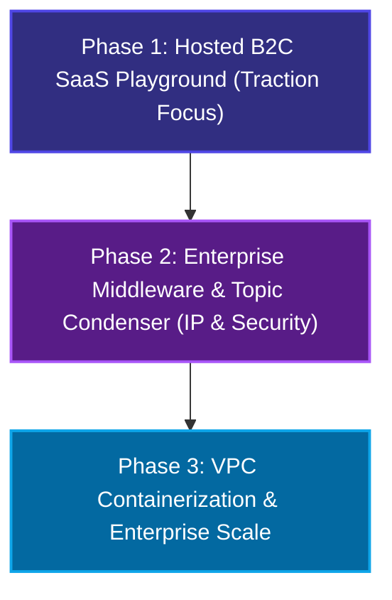

# NeuraStitch AI: Product Blueprint & Startup Pitch
### *The Decoupled Enterprise Memory Fabric & Git-Like Context Controller*

---

## 1. Executive Summary

### The Elevator Pitch
NeuraStitch is the world's first **decoupled, provider-agnostic memory middleware for enterprise AI agents**. We separate stateful conversation memory from stateless LLM reasoning. By installing our lightweight memory fabric directly inside a client's private cloud (AWS/GCP VPC) and utilizing their own secure Big Tech API contracts (or local models), we allow large enterprises (banks, law firms, healthcare systems) to run complex, long-term stateful agent swarms with **zero data leaks, zero provider lock-in, and 85% lower token costs**.

---

## 2. The Core Problem (The Enterprise AI Bottleneck)

Enterprises are facing a massive paradox when deploying AI agents:
1. **The Data Leak Threat**: Large companies refuse to use standard SaaS AI startups because they are legally prohibited from letting a startup store customer profiles, transaction details, or proprietary legal documents.
2. **The LLM Caching & Forgetting Gap**: Standard LLMs are stateless. As conversations or debugging loops grow, developers must feed massive histories into the prompt. This creates **extremely slow response times**, **astronomical token costs**, and causes the LLM to **hallucinate or forget** earlier critical instructions.
3. **The Provider Lock-In Trap**: Companies are terrified of building their entire AI infrastructure around a single provider (like OpenAI’s proprietary Assistant APIs) because migrating their memory database to Claude or an offline Llama model later is a multi-million-dollar system rewrite.

---

## 3. The NeuraStitch Paradigm: Decoupled Memory Middleware

NeuraStitch resolves these barriers by acting as the **secure database broker** inside the client's own cloud perimeter.

```
┌──────────────────────────────────────────────────────────────────────────┐
│                          Enterprise Secure VPC                           │
│                                                                          │
│  ┌───────────────────────┐                    ┌───────────────────────┐  │
│  │   Neon PostgreSQL     │                    │     Qdrant Cloud      │  │
│  │  Relational State DB  │◄──────────────────►│  Vector Memory Index  │  │
│  └───────────▲───────────┘    Synced Mapping  └───────────▲───────────┘  │
│              │                                            │              │
│              │             Reads / Writes                 │              │
│              └───────────────────┬────────────────────────┘              │
│                                  ▼                                       │
│                      ┌───────────────────────┐                           │
│                      │    NeuraStitch Core   │                           │
│                      │    State Engine       │                           │
│                      └───────────▲───────────┘                           │
└──────────────────────────────────┼───────────────────────────────────────┘
                                   │
                                   │ HTTPS POST (Stateless / ZDR Prompts)
                                   ▼
                       ┌───────────────────────┐
                       │  Stateless LLM Cloud  │
                       │ (Azure OpenAI / Vertex)│
                       └───────────────────────┘
```

### How It Works:
* **Zero Startup Server Access**: We never host the client's database. The Postgres (relational timeline) and Qdrant (semantic vector space) databases are installed directly inside **their** private cloud VPC.
* **Stateless API Integration**: NeuraStitch formats prompt context locally inside their VPC, queries the stateless LLM (e.g., Azure OpenAI under their Zero-Data-Retention corporate agreement), receives the raw answer, and updates the local databases. **No proprietary business logs or history files are ever stored by the LLM provider.**

### 3.1 Hard Enterprise Objections & Resolutions (The Privacy & Trust Moat)

> [!CAUTION]
> **Critical Objection**: *"Isn't the actual reason companies refuse to adopt AI that they fear the major LLM providers (OpenAI, Google) will steal their proprietary data or train on their inputs? With our decoupled memory middleware, the data is still sent to these LLM APIs—so why would an enterprise pay for our service?"*

#### The NeuraStitch Resolution:

To win in the enterprise sector, we address this objection through two distinct market realities:

#### Reality 1: The "ZDR Contract" Separation (Stateless Big-Tech vs. State-holding Startups)
Large enterprises (banks, insurance firms, hospitals) **do not** use public web wrappers where LLM providers train on inputs. Instead, they sign highly strict, legally-negotiated **Enterprise Zero-Data-Retention (ZDR)** or **Business Associate Agreements (BAA)** directly with Microsoft Azure OpenAI, Google Vertex AI, or AWS Bedrock.
* Under these contracts, the LLM is legally prohibited from caching, logging, or training on inputs. It operates as a **purely stateless, real-time processing unit** (it processes the prompt, returns the token stream, and instantly purges the text from RAM).
* **The Unmet Problem**: Even though the LLM is stateless and safe, the enterprise *still* needs to store their historical customer profiles, RAG vectors, and conversational states somewhere! 
* **Our Moat**: If they hire a standard AI SaaS startup, the startup demands: *"We must host your conversation database on our startup servers."* This is the immediate dealbreaker. 
* **The Pitch**: We tell the enterprise: *"Keep using the ZDR Big-Tech contracts you already legally trust. We will install NeuraStitch's stateful memory database **100% inside your private cloud**. We never see your data, and the startup's servers are completely bypassed."*

#### Reality 2: The "Air-Gapped" Local LLM Stack (100% Offline & In-VPC)
For highly regulated sectors (defense contractors, national security, Swiss private banks) that **refuse to send a single character** over the public internet:
* NeuraStitch is fully **provider-agnostic**. The Postgres and Qdrant memory layers are deployed locally on the client's internal servers.
* NeuraStitch is routed directly to **locally-hosted, open-source models** (like Llama-3, Mixtral, or DeepSeek) running on their private GPU hardware (using private `vLLM` or `Ollama` endpoints).
* **Result**: The company gets a **100% offline, air-gapped, zero-leak stateful AI system**. Data never touches a public wire, and they still benefit from NeuraStitch's visual Git timeline control and Context Condensation!

---

## 4. Key Product Features & Innovations

To maximize launch speed and IP security, the NeuraStitch features are split into two parallel product lines:

### PART A: Hosted B2C SaaS Playground (Initial Launch)

#### Feature 1: "Git-Like" Context State Control (Visual Node Branching)
Instead of treating conversations as linear, flat chat feeds, NeuraStitch treats conversations as a **version-controlled tree of context nodes**, styled like a developer’s Git graph.

```
                  ┌───► Node 2a (Claude 3.5: Creative Refactoring)
                  │
Node 0 ────► Node 1 ────► Node 2 (GPT-4o: Structural Analysis)
                  │
                  └───► Node 2b (Local Llama-3: Offline Verification)
```

* **Branching Context**: A user can click on any past chat bubble (Node 1) in their history, select **"Branch Here,"** and spawn a parallel reasoning path (Node 2a). This allows testing different prompts or models on the exact same historical background without polluting the main thread.
* **Single-Parent Context Branching Tree**: By avoiding the complexity of merging, we maintain an elegant, high-performance PostgreSQL Tree structure (`parent_node_id` foreign keys) that renders beautifully using React Flow with zero database query overhead.

#### Feature 2: Context-Preserving Provider Hot-Swapping
* Mid-conversation, a developer can change the active model on a specific branch from GPT-4o to Claude 3.5 Sonnet. NeuraStitch automatically reformats and carries over the history, letting the new model pick up the conversation seamlessly.

#### Feature 3: Deep-Linked Session Sharing & Forking (The Traction Loop)
* Users can generate a read-only public URL for any conversation branch tree. Colleagues or followers can explore the tree and click **"Fork Tree"** to clone the exact context path directly into their own NeuraStitch workspace to continue the chat using their own API keys.

---

### PART B: Private B2B Enterprise Middleware (Phase 2 & 3 Development)

#### Feature 4: Semantic-Based Topic-Clustered Context Condenser
Most memory systems compress history chronologically (which mixes different topics and dilutes embeddings). NeuraStitch introduces **Semantic Clustering & Causal Consolidation**:
1. **Semantic Grouping**: The engine scans Qdrant to group completed chat turns into **topic clusters** (regardless of when they occurred).
2. **Causal Timeline Preservation**: The LLM compiles each semantic cluster into a high-density **"Topic Card"** (`system_summary`) that preserves the strict cause-and-effect timeline of events using timestamps.
3. **Pruning & RAG Optimization**: The raw messages are deleted from the active window, and only the precise Topic Cards are stored and embedded, **saving up to 85% in token costs**.

#### Feature 5: Cryptographic Namespace Isolation (Wall Street Chinese Wall)
* Multi-tenant security for consulting and legal giants. Every client dataset is encrypted with unique envelope keys managed via **AWS KMS** or **HashiCorp Vault**. Even under backend routing bugs, Agent A physically cannot decrypt or access Agent B's database records or vector indices.

#### Feature 6: Air-Gapped Local LLM Bridging (100% Offline)
For ultra-secure environments (defense, national intelligence, Swiss banks), NeuraStitch can be configured to run **fully offline**:
* The memory layer runs locally in the client's data center.
* The LLM calls are routed to a **locally-hosted open-source model** (like Llama-3 or Mixtral running on their private GPU servers).
* **Result**: A powerful, state-of-the-art agent workstation with absolutely zero internet connection.

---

---

## 5. Technical Database Architecture

### Relational Database Schema (Neon PostgreSQL)
To power the Git-like graph structure, Postgres maps the conversation as a tree:

```sql
CREATE TABLE conversation_nodes (
    id VARCHAR(255) PRIMARY KEY,       -- Unique Node UUID
    session_id VARCHAR(255) NOT NULL,   -- Active Thread ID
    branch_id VARCHAR(255) NOT NULL,    -- Active Branch (e.g., 'main', 'experimental-1')
    parent_node_id VARCHAR(255),        -- Link to parent node (NULL for Root Node)
    role VARCHAR(50) NOT NULL,          -- 'user', 'assistant', 'system_summary'
    content TEXT NOT NULL,              -- Actual text content
    model_used VARCHAR(100),            -- LLM model that generated this node
    timestamp TIMESTAMP DEFAULT CURRENT_TIMESTAMP,
    is_condensed BOOLEAN DEFAULT FALSE, -- Flagged once compressed into a Topic Card
    FOREIGN KEY (parent_node_id) REFERENCES conversation_nodes(id)
);
```

### Vector Database Payload Schema (Qdrant)
Each vector in Qdrant represents a semantic point mapped directly back to a relational node:

```json
{
  "id": "qdrant-vector-uuid",
  "vector": [0.123, -0.456, ..., 0.789], // Truncated 768-dim coordinates
  "payload": {
    "node_id": "postgres-conversation-node-uuid",
    "session_id": "session-default",
    "branch_id": "main",
    "topic_tag": "database-caching-outage",
    "content": "Running container cached the old database credentials..."
  }
}
```

---

## 6. Competitor Landscape & Market Moat

| Competitor | What They Do | Where They Fail | NeuraStitch Moat |
| :--- | :--- | :--- | :--- |
| **LangGraph / CrewAI** | Developer frameworks for stateful multi-agent systems. | Extremely complex to build from scratch; lack visual tools and plug-and-play UI; memory cleaning is basic. | **Visual Git-Timeline Explorer & Out-of-the-Box API Middleware** that integrates in minutes, not weeks. |
| **Letta (MemGPT)** | Stateless LLM OS framework. | Academic focus; very heavy; no simple visual dashboard for corporate analysts. | **Ultra-lightweight design** and elegant visual timeline control specifically made for business and dev-teams. |
| **Dify.ai / Flowise** | Self-hosted low-code builders. | Basic memory systems (simple text sliding windows or raw RAG). They lose the chronological timeline of events. | **Topic-Similarity Context Condenser** that preserves cause-and-effect causality inside high-density Topic Cards. |

---

## 7. Business & Monetization Strategy

As a startup founder, our pricing model scales directly with the value we deliver:

1. **VPC License fee (Enterprise Core)**: 
   * Annual subscription (e.g., $50,000/year) to deploy NeuraStitch inside the client's AWS/GCP cloud. Includes dedicated support and custom database integrations.
2. **Value-Based "Compression" Pricing (B2B API)**:
   * For middle-market developers using our hosted API: We charge a fraction of a cent per token compressed. **Because our Context Condenser reduces their active LLM token spend by 85%, our service literally pays for itself.**
3. **Professional Services (Enterprise Onboarding)**:
   * Consulting fees to construct custom multi-agent graphs, migrate legacy SQL records, and configure local GPU/Llama-3 architectures.

---

## 8. Startup Roadmap: The Dual-Track Velocity Playbook

To maximize speed-to-market and IP protection, NeuraStitch operates on a **100% proprietary, closed-source Dual-Track development roadmap**. We launch a high-traction, hosted consumer/developer SaaS playground immediately to generate organic viral growth, while developing our heavy-duty enterprise VPC middleware in parallel.



### Phase 1: Hosted B2C SaaS Playground (Active Launch & Traction Loop)
* **Objective**: Build immediate user traction, viral word-of-mouth on developer channels, and validate UI/UX loops.
* **The Deliverable**: A beautiful, premium, hosted dark-mode web application where individual developers, writers, and power-users sign up, plug in their own API keys (BYOK via OpenRouter/OpenAI/Anthropic), and chat with multiple models.
* **Core Launch Features**:
  * Proprietary **Visual Node Branching Tree UI** (powered by a customized, closed-source React Flow implementation) to let users click past nodes, spawn branches, and swap models.
  * Dynamic context-preserving provider hot-swapping and collaborative session saving (allowing users to share deep-linked, read-only session trees).
* **Traction Hook**: Free tier for basic branching; premium subscription for unlimited branches, saved session histories, and advanced context migration.

### Phase 2: Enterprise Middleware & Advanced RAG (Parallel B2B Development)
* **Objective**: Build the heavyweight enterprise logic while Track 1 generates cash flow, branding, and user insights.
* **Core Development Features**:
  * **Semantic-Based Topic-Clustered Context Condenser** in the backend, grouping Qdrant messages by topic similarity and compiling them into timeline-anchored Topic Cards.
  * **Hybrid RRF Retrieval Engine** blending semantic similarity with Postgres time-decay causality.
  * **Cryptographic Namespace Isolation** (AWS KMS/HashiCorp Vault envelope encryption) to support zero-risk multi-tenant enterprise data partitioning.

### Phase 3: The Enterprise VPC Platform (Scale & Monopolize)
* **Objective**: Close high-ticket, high-security enterprise licenses.
* **The Deliverable**: A secure, containerized **Docker / Kubernetes Helm Chart** deployed directly inside the client's private AWS/GCP VPC.
* **Core Enterprise Features**:
  * Strict Air-Gapped Local Model integrations (direct routing to in-VPC Llama-3/Mixtral GPU servers via Ollama/vLLM).
  * Enterprise Single Sign-On (SSO / SAML), advanced role-based access control (RBAC), and SOC-2/HIPAA compliance packs.

---

## 9. Enterprise Ideal Customer Profiles (ICPs) & Real-World Use Cases

To prove commercial viability, NeuraStitch targets three massive, highly-regulated corporate sectors with specific, high-value business use cases:

### Case Study A: UnitedHealth Group (Healthcare & Insurance Prior-Authorization)
* **The Target**: UnitedHealth Group (the world's largest healthcare company).
* **The Operation**: Case managers and AI agents reviewing patients' longitudinal clinical histories to automatically approve or deny prior-authorization for surgeries, advanced therapies, or medications.
* **Why They Need NeuraStitch**:
  * **HIPAA Compliance**: Patient health information (PHI) cannot be stored on a startup's servers or used to train public models. NeuraStitch installs 100% inside UnitedHealth's private cloud.
  * **Lossless Clinical Timeline**: Prior-authorization decisions require cross-referencing years of doctor visits, drug histories, and lab results.
* **What Data Gets Stored in the Private Databases**:
  * **PostgreSQL (Structured Timeline)**: Anonymized patient keys, chronological clinic checkup dates, and prior approval history rows.
  * **Causal Topic Cards (Context Condenser)**: Highly dense summaries of chronic conditions compiled by the condenser (e.g., `[PATIENT STATE: Diagnosed with Type-2 Diabetes in 2022 -> prescribed Metformin 500mg -> developed mild kidney strain in 2024 -> Metformin paused -> now requesting Jardiance approval]`).
  * **Qdrant (Semantic Index)**: Vector embeddings of doctor-patient consult transcripts, symptom descriptions, and clinical metrics mapped directly to Postgres node UUIDs.

### Case Study B: DLA Piper (Large-Scale Corporate M&A Due Diligence)
* **The Target**: DLA Piper (one of the largest global law firms).
* **The Operation**: An army of autonomous contract auditor agents reading through thousands of pages of corporate documents, searching for hidden liabilities, debt clauses, and regulatory non-compliance during corporate acquisitions.
* **Why They Need NeuraStitch**:
  * **Attorney-Client Privilege**: Any leak of upcoming merger details (like an unannounced corporate buyout) through a third-party startup server is a catastrophic legal disaster and a massive SEC insider trading liability.
  * **Unified Case Context**: Lawyers need to know how a specific environmental clause in a lease agreement affects a larger corporate parent's liability profile.
* **What Data Gets Stored in the Private Databases**:
  * **PostgreSQL (Structured Timeline)**: Active audit logs, contract clause IDs, task states, and parent-child task links for paralegal agents.
  * **Causal Topic Cards (Context Condenser)**: High-density legal risk summaries compiled by the condenser (e.g., `[LORE CARD: Target Company has a hidden debt liability in Section 4.2 of their 2023 credit agreement -> trigger event: sale of assets -> result: potential $10M fine if not refinanced before acquisition]`).
  * **Qdrant (Semantic Index)**: Vector embeddings of individual contract clauses, corporate leases, email archives of the target company, and past judicial precedents.

### Case Study C: McKinsey & Company (Global Management Consulting & Strategic Swarms)
* **The Target**: McKinsey & Company (the world's top management consulting firm advising Fortune 100 corporate boards on market expansions, competitive strategies, and acquisitions).
* **The Operation**: Deploying autonomous **"Strategic Swarm"** agents to gather global market intelligence, analyze competitor balance sheets, perform scenario forecasting, and draft strategic board presentations.
* **Why They Need NeuraStitch (The McKinsey Solution)**:
  * **Confidential Strategic Isolation (Multi-Tenancy Moat)**: McKinsey consultants often advise competing companies in the same sector (e.g. advising Company X and Company Y). An independent, secure memory layer guarantees that **Company X's strategic memory vectors are kept strictly air-gapped and isolated** from Company Y's memory vectors (using separate Qdrant collections or namespace-scoped Postgres databases), preventing catastrophic cross-contamination of confidential data.
  * **Stateless Strategy Synthesis (BYOK)**: Consultants can query advanced reasoning models (like Claude 3.5 Sonnet) *stateless-style* under zero-data-retention agreements. The secret McKinsey corporate strategy remains 100% inside McKinsey's private AWS servers.
  * **Historical Case-Knowledge Re-Use**: Over 80 years, McKinsey has built an invaluable, proprietary goldmine of past "Case Studies" and "Strategic Playbooks." NeuraStitch condenses these historical insights into high-density **"Strategy Playbook Cards"** in Qdrant. When a new consultant starts a project in a similar sector, they query NeuraStitch, instantly pulling past consulting insights without repeating the research.
* **What Data Gets Stored in the Private Databases**:
  * **PostgreSQL (Structured Timeline)**: Client engagement IDs, industry parameters, project timelines, and structured market variables.
  * **Causal Topic Cards (Context Condenser)**: High-density strategic summaries of competitor activities compiled by the condenser (e.g., `[STRATEGIC CARD: Competitor X expanded production capacity in Southeast Asia by 20% in Q3 -> direct threat: client's market share -> response proposal: price adjustment in Europe]`).
  * **Qdrant (Semantic Index)**: Vector embeddings of industry market research reports, competitor financial balance sheets, and proprietary historical consultant case studies.
